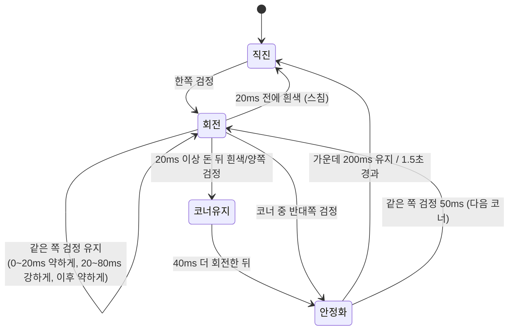

# 라인트레이서 — IoT 임베디드실습 팀 프로젝트

Arduino UNO 기반 라인트레이서입니다. 검정 선을 따라 코스를 돌고, 초음파 센서로 벽을 감지해
벽 앞 10cm 근처에서 멈췄다가 벽을 치우면 다시 출발합니다.

## 평가 기준 요약

| 항목 | 점수 | 조건 |
|---|---|---|
| 모퉁이 통과 | 4개 × 10점 | 통과한 구간까지 점수 |
| 벽 앞 정지 | 2개 × 10점 | 벽에서 10cm ± 5cm 안에 정지, 3초 정지 후 벽을 치우면 재출발. 부딪히면 점수 없음 |
| 주행 순위 | 1등 40 / 2등 30 / 3등 20 / 4등 10 | 전체 완주 시간 기준 |

- 코스는 약 2m × 2m, 모서리가 둥근 사각형입니다(슬라이드 그림 기준, 당일 확인 필요).
- 팀별 2회 주행, 높은 점수 반영. 출발 후 5분 안에 완주해야 합니다.
- 하드웨어 튜닝·부품 교체는 불가합니다.

## 빌드와 업로드

### Arduino IDE

`linetracer/linetracer.ino`를 엽니다. 필요한 라이브러리(AFMotor, 초음파 드라이버)는 `linetracer/src/`에
들어 있어서 따로 설치할 필요가 없습니다. 보드를 Arduino Uno로 고르고 업로드합니다.

### CMake (avr-gcc)

```sh
cmake --preset avr                     # 처음 한 번 구성
cmake --build --preset avr             # 빌드 (.hex 생성, 크기 출력)
cmake -B build -DUPLOAD_PORT=COM5      # 업로드 포트 지정 (한 번)
cmake --build build --target upload    # avrdude로 업로드
```

`CMAKE_TOOLCHAIN_FILE` 환경 변수가 다른 툴체인(vcpkg 등)을 가리키고 있으면 AVR 툴체인 대신 그쪽이
쓰입니다. 프리셋을 쓰거나 `-DCMAKE_TOOLCHAIN_FILE=cmake/avr-toolchain.cmake`를 직접 넘기세요.

## 저장소 구성

| 경로 | 역할 |
|---|---|
| `linetracer/main.cpp` | `setup()`/`loop()`. 벽 정지 판단 후 라인 주행 한 단계 호출 |
| `linetracer/drive.cpp` | 라인 주행 알고리즘 (아래 설명의 핵심) |
| `linetracer/calibration.cpp` | 측정 모드. 정해진 PWM으로 일정 시간 달려 속도·회전량을 잰다 |
| `linetracer/trace_log.*` | 주행 기록을 EEPROM에 남기고 다음 부팅 때 시리얼로 출력 (현재 미사용, 아래 참고) |
| `linetracer/src/AFMotor/` | L293D 모터 실드 라이브러리 |
| `linetracer/src/range/` | 초음파 거리 센서 드라이버 (Timer1 인터럽트로 60ms마다 측정) |
| `cmake/`, `CMakeLists.txt`, `CMakePresets.json` | CMake 빌드 설정 |

---

## 주행 알고리즘

코드를 처음 보는 팀원도 이 설명만 읽고 값을 조정할 수 있도록 썼습니다.

### 1. 하드웨어 전제

| 항목 | 내용 |
|---|---|
| 보드 | Arduino UNO + L293D 모터 실드(AFMotor 라이브러리) |
| 바퀴 | M1 = 왼쪽, M4 = 오른쪽 |
| 라인 센서 | 디지털 IR 2개. A0 = 왼쪽, A5 = 오른쪽. `HIGH` = 검정(선), `LOW` = 흰색 |
| 센서 배치 | 두 센서 간격 약 5cm, 선(절연테이프) 폭 약 1.7cm. 선이 두 센서 **사이**에 있으면 둘 다 흰색 |
| 거리 센서 | 초음파. 60ms마다 한 번 거리 측정 |
| 엔코더 | 없음. 바퀴가 실제로 얼마나 돌았는지는 알 수 없다 |

센서가 디지털이라 "선이 얼마나 벗어났는지"는 알 수 없고, **어느 쪽 센서가 선을 밟았는지**와
**얼마나 오래 밟고 있는지**만 알 수 있습니다. 알고리즘 전체가 이 두 정보(방향, 시간)로 움직입니다.

### 2. 전체 흐름 (`main.cpp`)

```
loop() 매 회
 ├─ 초음파 거리 읽기
 ├─ 벽 정지 판단 (아래 표)
 ├─ 정지 중이면: 모터 끔
 └─ 아니면: line_follow_step()  ← drive.cpp
```

`delay()`를 전혀 쓰지 않습니다. `loop()`가 아주 빠르게 반복되면서 매번 센서를 다시 읽고,
"몇 ms 동안 이 상태였는가"는 `millis()`로 잰 시각 차이로 판단합니다.

#### 벽 정지

| 조건 | 동작 |
|---|---|
| 거리 ≤ `WALL_STOP_MM`(155mm) | 정지 (`drive_stop()`, 모터 RELEASE) |
| 정지 중이고 거리 ≥ `WALL_RESUME_MM`(200mm) | 다시 출발 |
| 초음파 응답이 없음(`UNKNOWN`) | 정지하지 않음 (센서 이상으로 계속 서 있는 것 방지) |

- 정지 기준과 출발 기준을 다르게 둔 것(히스테리시스)은 경계 거리에서 섰다 갔다를 반복하지 않게 하려는 것입니다.
- 평가 기준은 벽에서 10cm ± 5cm입니다. 실차에서 **차체 맨 앞 기준**으로
  135mm → 6~7cm, 170mm → 13cm, 155mm → 평균 11cm에 서서 155mm로 정했습니다.
  기준값보다 덜 가서 서는 것은 센서~차체 앞부분 거리와, 60ms 측정 간격 동안 차가 더 가는 거리 때문입니다.

### 3. 라인 주행 (`drive.cpp`)

#### 3.1 기본 동작 세 가지

| 이름 | 함수 | 바퀴 명령 |
|---|---|---|
| 직진 | `straight()` | 왼쪽 170 / 오른쪽 204 전진 |
| 제자리 회전 | `pivotToward(dir)` | 한쪽 150 전진, 반대쪽 150 후진 (`dir` +1 = 우회전, -1 = 좌회전) |
| 완만한 조향 | `gentleTurn(dir, ...)` | 30ms 주기 중 앞부분 몇 ms만 제자리 회전, 나머지는 150/150 전진 |

**완만한 조향**은 "짧은 회전 펄스 + 전진"을 30ms마다 반복하는 방식입니다. 회전하는 시간 비율(예: 30ms 중
12ms = 40%)로 꺾는 세기를 조절하는 것이라, PWM 듀티비로 밝기를 조절하는 것과 같은 원리입니다.

**직진 PWM이 좌우 다른 이유**: 같은 PWM이면 차가 오른쪽으로 휩니다. 바퀴는 PWM이 일정 값(데드밴드,
왼쪽 약 39, 오른쪽 약 47)을 넘어야 돌기 시작하고, 그 위로는 오른쪽 바퀴가 PWM당 덜 빠릅니다.
측정해 보니 데드밴드를 뺀 나머지를 1 : 1.2로 주면 직진했습니다. 그래서 왼쪽 L이면 오른쪽은
`47 + (L - 39) × 1.2`입니다 (150 → 180, 170 → 204).

#### 3.2 평소 주행: 센서 네 가지 경우

```
            왼쪽(A0)   오른쪽(A5)
경우 1        흰색       흰색      선이 두 센서 사이 (또는 놓침)
경우 2        흰색       검정      선이 오른쪽으로 치우침 → 우회전
경우 3        검정       흰색      선이 왼쪽으로 치우침   → 좌회전
경우 4        검정       검정      선을 가로지름(코너 등)
```

**경우 2, 3 — 한쪽만 검정**

그쪽으로 돕니다. 세기는 **그 센서가 검정을 본 지 얼마나 됐는지**로 정합니다.

| 검정이 이어진 시간 | 동작 | 이유 |
|---|---|---|
| 0 ~ 20ms | 완만한 조향 (30ms 중 12ms 회전) | 직선에서 살짝 스친 것일 수 있어 약하게 고친다 |
| 20 ~ 80ms | 계속 제자리 회전 | 20ms 넘게 밟고 있으면 코너로 본다 (`cornerCommitted = true`) |
| 80ms 이후 | 다시 완만한 조향 | 계속 강하게 돌면 선을 지나쳐 버린다 |

**경우 1 — 양쪽 흰색**

- 코너를 돌던 중이었다면(20ms 이상 한쪽으로 돌았다면): 선이 사라진 뒤에도 **40ms 더 같은 쪽으로
  제자리 회전**합니다. 급한 곡선에서는 센서가 선을 바깥으로 지나쳐 버리기 때문에, 조금 더 돌아서
  선을 다시 센서 사이로 가져오는 동작입니다. 그 뒤 **안정화(3.3)** 로 넘어갑니다.
- 아니면: 선이 가운데 있는 것이므로 직진합니다.

**경우 4 — 양쪽 검정**

- 코너 중이면 경우 1과 같이 40ms 더 돌고 안정화로 넘어갑니다.
- 아니면 직진합니다.

**코너 직후 반대쪽 센서가 검정**

코너를 돌고 나면 차가 살짝 지나치게 돌아서 반대쪽 센서가 선을 밟는 일이 많습니다. 이때 바로 반대로
강하게 돌면 좌우로 크게 흔들리므로, 반대로 돌지 않고 **안정화**로 넘어가 약하게 고칩니다.

#### 3.3 안정화 (코너를 돈 뒤 최대 1.5초)

코너를 막 빠져나온 차는 방향이 아직 덜 맞아 있어서, 평소보다 **약하게** 조향하며 선 위에 자리 잡게 합니다.

| 센서 | 동작 |
|---|---|
| 한쪽 검정 | 완만한 조향, 30ms 중 8ms 회전. 같은 쪽이 35ms 넘게 이어지면 12ms 회전으로 키움 |
| 양쪽 같은 색 | 직진 |

안정화가 끝나는 조건은 셋 중 먼저 오는 것입니다.

| 조건 | 판단 | 이후 |
|---|---|---|
| 한쪽을 본 뒤 양쪽 흰색이 200ms 이어짐 | 선 가운데에 자리 잡았다 | 직진, 평소 주행으로 |
| 1.5초 지남 | 시간 초과 | 평소 주행으로 |
| 같은 쪽 검정이 50ms 이어짐 | 바로 다음 코너가 왔다 | 그쪽으로 평소 주행의 회전 시작 |

#### 3.4 상태 흐름



### 4. 조정 가능한 값

값은 모두 `drive.cpp`와 `main.cpp` 맨 위에 상수로 모여 있습니다.

| 상수 | 현재 | 올리면 | 내리면 |
|---|---|---|---|
| `LINE_STRAIGHT_LEFT_PWM` / `RIGHT` | 170 / 204 | 빠름(순위↑), 모퉁이 놓칠 위험 | 느림, 안정 |
| `LINE_CORNER_PWM` | 150 | 회전이 세짐, 급한 곡선에 유리. 너무 크면 직선에서 흔들림 | 회전이 약해짐 |
| `LINE_PIVOT_START_MS` / `END_MS` | 20 / 80 | 강한 회전 구간의 시작/끝 | |
| `LINE_CORNER_HOLD_MS` | 40 | 선이 사라진 뒤 더 도는 시간. 바깥으로 빠지면 늘림 | 안쪽으로 너무 돌면 줄임 |
| `LINE_GENTLE_PIVOT_MS` | 12 | 완만한 조향이 세짐 | 약해짐 |
| `WALL_STOP_MM` | 155 | 벽에서 더 멀리 섬 | 더 가까이 섬 (1mm당 약 1.9mm 움직였음) |

**직진 속도를 바꿀 때**는 좌우 비율을 유지합니다: 오른쪽 = `47 + (왼쪽 - 39) × 1.2`.

| 왼쪽 | 140 | 150 | 160 | 170 | 180 |
|---|---|---|---|---|---|
| 오른쪽 | 168 | 180 | 192 | 204 | 216 |

실차 시험 결과 170/204까지는 모퉁이를 돌았고 180/216부터 놓쳤습니다.

### 5. 알려진 한계

- **완전 직각은 못 돕니다.** 센서 2개로는 "선이 두 센서 사이에 있음"과 "직각에서 선을 놓침"이
  둘 다 양쪽 흰색이라 구별되지 않습니다. 평가 코스는 모서리가 둥근 사각형이라 문제가 되지 않지만,
  당일 연습 시간에 실제 코스를 꼭 확인해야 합니다.
- **배터리 상태에 따라 속도가 달라집니다.** 같은 PWM이라도 배터리가 닳으면 느려지고, 완충이면
  빨라집니다. 지금 값은 시험할 때의 배터리 상태 기준이므로, 완충 상태에서 모퉁이를 놓치면
  직진을 160/192로 한 단계 낮추세요.
- **벽 정지 위치는 매번 1~2cm 흔들립니다.** 초음파가 60ms마다 한 번만 재기 때문에 그 사이에
  차가 약 1.8cm(170/204 기준) 갑니다.

### 6. 보조 기능

#### 측정 모드 (`calibration.cpp`)

`main.cpp`의 `CALIBRATION_MODE`를 `true`로, `calibration.cpp`의 `TEST_NUMBER`를 원하는 번호로 바꿔
업로드하면, 전원을 켜고 3초 뒤 정해진 PWM으로 한 번 달리고 멈춥니다. 간 거리나 돈 각도를 자로 잽니다.

| 번호 | 왼쪽 / 오른쪽 PWM | 시간 | 재는 것 |
|---|---|---|---|
| 1 | 150 / 180 | 2초 | 직진 거리 (측정값 약 50cm) |
| 2 | 200 / 240 | 2초 | 직진 거리 (약 72cm) |
| 3 | 150 / -150 | 3초 | 제자리 회전 각도 (약 320도) |
| 4 | 150 / 180 | 1초 | 직진 거리 (1번과 비교해 출발 가속 손실) |
| 5 | 254 / 0 | 2초 | 한 바퀴를 세운 원호 우회전 각도 |
| 6 | 0 / 254 | 2초 | 원호 좌회전 각도 |

배터리 상태에 따른 속도 변화를 확인할 때 1번을 다시 돌려 50cm와 비교하면 됩니다.

#### 주행 기록 (`trace_log.*`)

주행 중 센서·모터 값을 RAM에 기록해 두었다가, 벽 앞에서 1초 넘게 서 있으면 EEPROM에 저장하고, 다음에
USB를 연결해 시리얼 모니터(115200)를 열면 CSV로 출력하는 기능입니다. 다른 주행 알고리즘을 시험할 때
쓰던 것이라 **현재 `drive.cpp`는 기록을 남기지 않습니다**(`trace_sample()`을 부르지 않음). 필요하면
`line_follow_step()` 끝에서 `trace_sample()`을 호출하도록 추가하면 됩니다.
